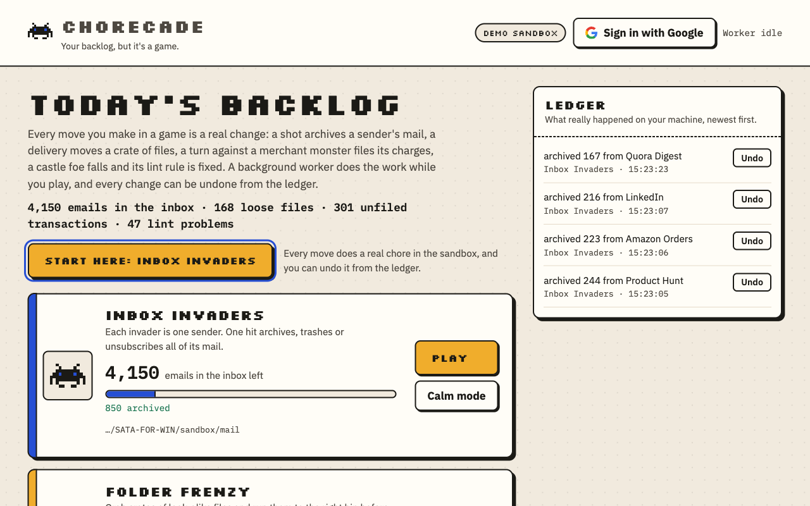
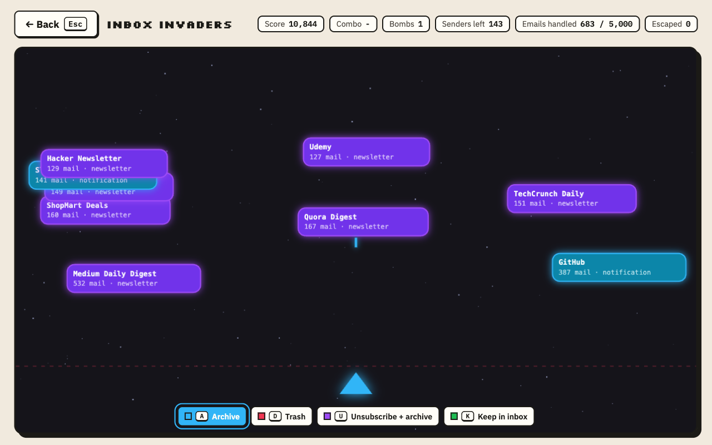
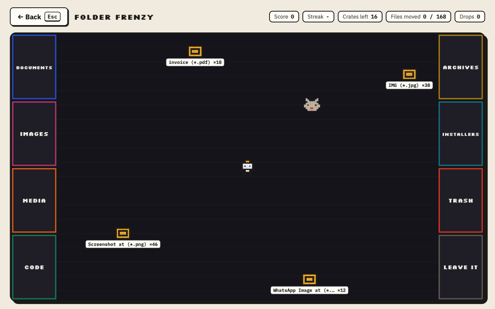
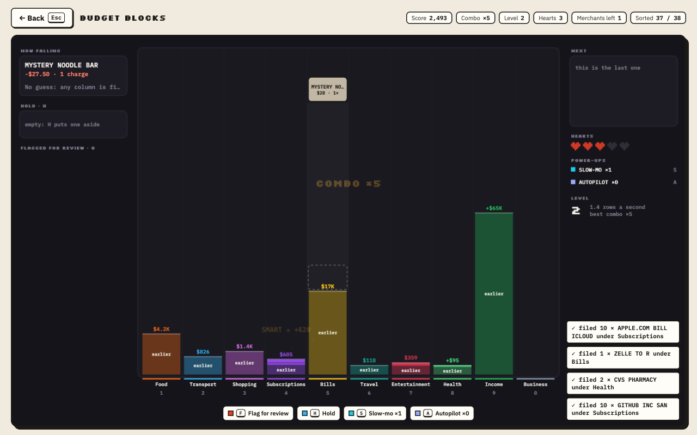
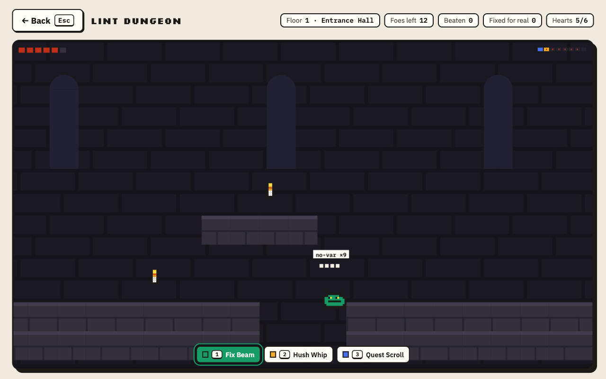
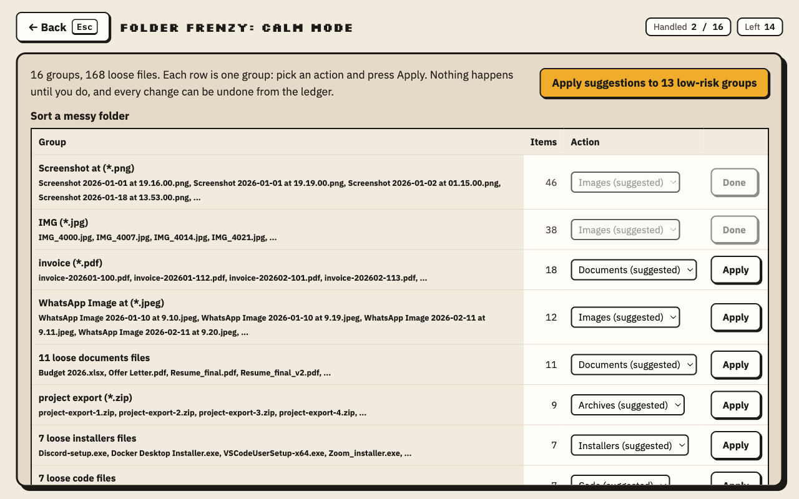
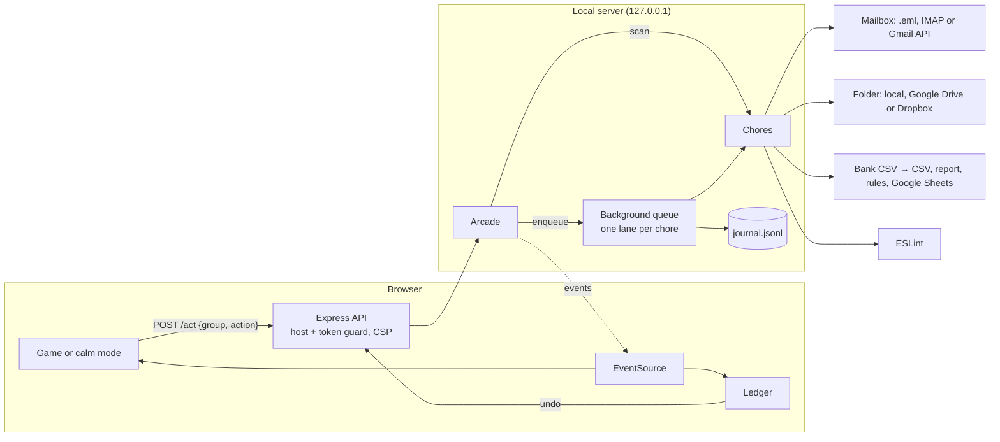

# ChoreCade

**Play a game. Finish a real chore.**

ChoreCade is an arcade where every move you make does a real chore in the background. Shoot down an invader and 400
emails from one sender are archived. Run a crate to the Images door and 46 screenshots move into `Images/`. Drop a
coffee-shop block into the Food column and a year of coffee purchases is filed there. Beam a crawler in the
castle and ESLint fixes `no-var` across your whole project. Sign in with Google and the same games work on your real Gmail and Drive.

We all put off the same digital chores: 5,000 unread emails, a Downloads folder nobody can look at, expenses nobody has
reviewed, a wall of lint warnings. They aren't hard, just boring and big. ChoreCade turns them into something you can
finish in a five-minute game session.

```bash
git clone https://github.com/hackathonwinner69-tech/SATA-FOR-WIN.git
cd SATA-FOR-WIN
npm install
npm run demo        # builds a sandbox and starts the arcade
```

Then open the link it prints, `http://localhost:4747/?token=…`. The link carries this run's key: the bare address shows a
locked page, so other programs on your machine can't drive the arcade. On the home screen, **Start here** opens Inbox
Invaders.

The demo never touches your real files. It builds a sandbox with a 5,000-email inbox, a cluttered Downloads folder, a
year of bank transactions and a small JavaScript app full of lint, and plays against those.



| Inbox Invaders | Folder Frenzy |
| --- | --- |
|  |  |
| **Budget Blocks** | **Lint Dungeon** |
|  |  |

## The cabinets

| Cabinet | The chore | The game, and how a move becomes real work |
| --- | --- | --- |
| **Inbox Invaders** | Triage 5,000 emails | A synthwave rail shooter with synthesised chiptune music and sound effects (press M to mute). Each saucer racing at you out of the sunset over the neon grid is one **sender**, sized by how much mail it sent. Archive laser, trash torpedo, unsubscribe pulse or keep beam: a hit moves every email from that sender. Shots curve onto ships you aim roughly at, newsletters shoot back at your three shields, and smart bombs apply ChoreCade's pick to every low-risk ship in view. People are shielded gold ships: the first trash or unsubscribe hit drops the shield, and only a second, separate press of fire confirms it. |
| **Folder Frenzy** | Sort a messy folder | An arena courier game. You drive a robot, pick up crates of look-alike files (`Screenshot … (*.png)` ×46) and run them to bin doors on the walls; a delivery moves the files. Dust bunnies chase you and knock crates loose, and a dropped crate changes nothing. Exact duplicates are red crates found by hash. |
| **Budget Blocks** | Review expenses | A falling-block game that doubles as a live chart. Each **merchant** falls as a block over ten category columns: steer it with the arrows, the number keys or a tap, and where it lands is where its charges are really filed. The glowing column is ChoreCade's guess and scores double; red blocks (possible duplicates or large charges) should be flagged for review instead. A block nobody steers files nothing, comes back later and costs a heart. Combos, a hold slot and slow-mo, autopilot, piggy-bank and payday power-ups keep the queue moving while the columns grow into a bar chart of your spending. The categorised CSV, `expense-report.md` and `merchant-rules.json` are rewritten as you play. |
| **Lint Dungeon** | Fix lint errors | A side-scrolling castle crawl in the Metroidvania tradition. Each **lint rule** is a foe: big rules are bosses, fixable ones crawl, the rest fly. Three weapons, three real actions: the Fix Beam runs ESLint's autofix for that rule (and only hurts foes ESLint can fix), the Hush Whip adds marked disable comments, the Quest Scroll writes it to `LINT_QUESTLOG.md`. Whip candles for hearts; the exit door opens when the floor is clear, and the next floor is a fresh lint pass. |

All characters, sprites and levels are original. The games borrow genre mechanics (bullet boxes, whips and beams, locked
doors and minimaps), not anyone's art, music or characters.

Every cabinet also has **Calm mode**: the same chore as a plain table with a native select and an Apply button per
group, with no timer and no canvas. See [Accessibility](#accessibility).



## Why grouping is the trick

Games are fast; chores are big. To close that gap, each move works on a **group**, not one item:

- 5,000 emails come from about 150 senders → **150 shots, not 5,000 decisions.**
- 168 loose files become 16 crates of look-alikes and duplicates.
- 301 transactions come from 27 merchants.
- 47 lint problems come from 12 rules.

Every group arrives with a suggestion (the ring around a ship, the lit door, the glowing column), so most moves are a quick
confirmation, and overruling the suggestion is just as fast.

## Google services

Sign in with Google from the masthead and two new cabinets appear, tagged **your real account**:

- **Inbox Invaders: Gmail.** Your real inbox through the Gmail API. Only headers are read (`format=metadata`), never
  bodies. Header fetches are batched (50 per request) and cached, and a token bucket paces calls under Gmail's
  per-minute quota. The first senders show within seconds while the rest of the inbox keeps loading in the background,
  and the game says how much is still being read. Archive removes the `INBOX` label (in batches of 1,000); trash uses
  Gmail's Trash, which keeps mail for 30 days. Both can be undone from the ledger.
- **Folder Frenzy: Drive.** A Drive folder (My Drive by default, `--drive-folder <id>` for another). Duplicates are found
  from Drive's `md5Checksum` without downloading anything; bin folders are created on demand; trash is Drive's trash,
  and moves go to the API in batches. Moves can be undone.
- **Export to Google Sheets.** The expenses cabinet gets an Export button that writes every transaction, its category and
  the totals into a new Google Sheet.

**Setup (about two minutes):**

1. In [Google Cloud Console](https://console.cloud.google.com/), create a project, then enable the **Gmail API**,
   **Google Drive API** and **Google Sheets API**.
2. Configure the OAuth consent screen ("External", add yourself as a test user).
3. Under **Credentials**, create an OAuth client ID of type **Desktop app**.
4. `cp .env.example .env` and fill in `GOOGLE_CLIENT_ID` and `GOOGLE_CLIENT_SECRET`. `.env` is git-ignored.
5. `npm run demo` (or `npm start`) and click **Sign in with Google**.

How sign-in is kept safe: it uses the OAuth 2.0 desktop flow Google recommends for installed apps: PKCE, a one-time
`state` that expires after ten minutes, and a loopback redirect to `127.0.0.1`. Only the refresh token (with the
granted scopes and your address) is stored, in `.chorecade/google-token.json`, written atomically with owner-only
permissions. **Sign out** revokes the grant at Google and tells you if Google didn't confirm it. Scopes are
`gmail.modify` (move mail; it cannot permanently delete) and `drive` (needed to sort files ChoreCade didn't create). If
you untick one on Google's consent screen, its cabinet is left out and the arcade says which. If Google later revokes the
sign-in, the Gmail and Drive cabinets go with it until you sign in again. Every Google call has a 30-second timeout, and
calls that create something (a Drive folder, a spreadsheet) are never retried after a server error, so they can't run
twice. Sheets values are written `RAW`, so a merchant named `=IMPORTXML(…)` stays text and never becomes a formula.

## Dropbox

Connect Dropbox from the masthead and a **Folder Frenzy: Dropbox** cabinet appears, tagged **your real account**. It
plays on one folder in your Dropbox (the root by default, `--dropbox-folder <path>` for another). Bin folders are
created on demand, duplicates are found from Dropbox's `content_hash` without downloading anything, and Trash is a
`ChoreCade Trash` folder, so nothing is ever deleted. Every move is journaled and undoable from the ledger.

**Setup (about two minutes):**

1. Create an app in the [Dropbox App Console](https://www.dropbox.com/developers/apps): **Scoped access**, then **Full
   Dropbox** or **App folder** (an App folder app only ever sees its own folder).
2. On the **Permissions** tab, enable `files.metadata.read` and `files.content.write` and submit (`account_info.read`
   is always on).
3. On the **Settings** tab, add the redirect URI `http://127.0.0.1:4747/oauth/dropbox/callback` (change the port if
   you run with `--port`), and leave **Allow public clients (PKCE)** enabled.
4. Copy the **App key** into `.env` as `DROPBOX_APP_KEY` (`cp .env.example .env` first; `.env` is git-ignored). There
   is no app secret to copy: sign-in uses PKCE.
5. Restart the arcade and click **Connect Dropbox**.

Sign-in uses the OAuth 2.0 flow with PKCE, a one-time `state` and a loopback redirect to `127.0.0.1`. Only the token
set is stored, in `.chorecade/dropbox-token.json`, owner-only. **Disconnect** revokes the grant at Dropbox and tells
you if Dropbox didn't confirm it; you can also remove the app any time under [connected
apps](https://www.dropbox.com/account/connected_apps). If Dropbox revokes the sign-in, the cabinet goes until you
connect again.

## Safety model

ChoreCade is allowed to move real mail and real files, so it's careful about it:

- **Everything is undoable.** Every change goes into an append-only journal (`journal.jsonl`) along with what undo needs.
  The ledger beside the cabinets lists each change with an Undo button.
- **Nothing is ever deleted.** "Trash" means Gmail's or Drive's trash, the mailbox's Trash folder, a
  `.chorecade-trash/` folder on disk, or a `ChoreCade Trash` folder in Dropbox: all of them are folders you can open.
- **Only deliberate moves act.** A crate you never pick up changes nothing; a merchant block is only filed where you steer
  it (a block you never touch files nothing); a lint foe only changes code when you defeat it. Trashing or unsubscribing a person in Inbox
  Invaders takes two separate presses of fire, so holding the button down can't do it.
- **Moves never overwrite.** If a name is already taken, the file lands as `name (2).ext` instead.
- **Undo is all-or-nothing and won't clobber.** File moves are reversed only if every original spot is still free. A
  lint undo is refused if the file has been edited since. An undo only runs against the folder or mailbox the change was
  made in, and only once.
- **A move that fails halfway can still be undone.** The part that already happened is journaled with its own Undo.
- **Unsubscribe is conservative.** RFC 8058 one-click POSTs only go out with `--one-click-unsubscribe` on live mail,
  and only to public HTTPS hosts: a link that points at this machine or your local network is refused. Otherwise links
  land in `unsubscribe-queue.md` to click yourself, with sender names escaped so an email can't plant links in it.
  Links are never fetched with GET.
- **Spreadsheet output stays data.** Cells in the categorised CSV that start with `=`, `+`, `-` or `@` (and aren't
  plain numbers) get a leading `'`, so a merchant name can't run as a formula in Excel or Sheets. The expense
  outputs are written atomically, so a crash never leaves half a file.
- **A display name can't impersonate an address.** `"support@paypal.com" <x@evil.test>` shows up as `x@evil.test`.
- **`--dry-run`** journals what would happen without changing anything.
- **The local server is locked down.** It binds to `127.0.0.1` and only opens from the link printed in the terminal,
  which sets an HttpOnly session cookie. Every API call also needs the per-run session token, compared in constant time.
  It refuses requests addressed to any other host name (DNS rebinding) and cross-origin requests, and sends a strict
  Content-Security-Policy (no inline scripts, no framing).
- **Paths stay inside the folder you named.** Symlinks are refused, including a bin, trash or output file that is
  really a link to somewhere else. The journal is owner-only (`0600`).
- **`--lint` runs the project's own ESLint config.** Like running `npx eslint` there, loading `eslint.config.js` runs
  that project's code and plugins. Only point it at projects you trust.

## Accessibility

- **Calm mode for every chore**: a real `<table>` with a caption, row headers, a labelled `<select>` per row, and a
  "apply suggestions to low-risk groups" button. No timer, no canvas: it works with a keyboard, a screen reader, or a
  switch device.
- Every real change is announced through a polite live region, and the ledger is always visible.
- Skip link, landmarks, visible focus rings, `role="dialog"` with labelled headings on game overlays, `aria-pressed`
  weapon buttons, distinct accessible names on every Play button, and focus returned to the button that opened a game.
  Esc leaves a game from anywhere, its intro and results cards included.
- Text colours meet WCAG AA contrast (4.5:1 or better) on the paper and card backgrounds.
- `prefers-reduced-motion` turns off screen shake, blinking, the guide arrow and most particles.
- Fonts (Silkscreen and IBM Plex, from Google Fonts) are self-hosted through Fontsource: no third-party requests, and the
  page works offline.

## Play with your real stuff

Point ChoreCade at the chores you want. Only those cabinets appear (plus Gmail and Drive once you sign in with Google, and Dropbox once you connect it).

```bash
npm start -- --files ~/Downloads                 # sort a real folder (top-level files only)
npm start -- --expenses ~/statements/2026.csv    # Date / Description / Amount, or Debit / Credit columns
npm start -- --lint ~/code/my-app                # uses (and runs) the project's own ESLint config: trusted projects only
npm start -- --mail ~/mail-export                # a folder of .eml files with an INBOX/
IMAP_PASS='app password' npm start -- --imap-host imap.example.com --imap-user you@example.com
npm start -- --files ~/Downloads --dry-run       # see what would happen first
```

### Optional: Claude as your sidekick

```bash
export ANTHROPIC_API_KEY=...
npm start -- --ai
```

With `--ai`, when the built-in rules can't place a pack of files (`output.dat`, `mystery.xyz`) or recognise a merchant
(`TST* MYSTERY NOODLE BAR`), Claude (`claude-opus-5-5`, structured output) suggests the bin or category the game
highlights. Claude only suggests; you still make every move. Only each group's label (a file-name pattern or a merchant
name), its count and, for merchants, its total are sent: never file contents, email addresses or subjects. Advice is
cached, so a rescan doesn't ask again.

## How it works



Every chore implements the same three-method interface, which is what makes a new chore (and a new game) cheap:

```js
scan()                 // → { groups: [{ id, label, count, suggestion, risk, ... }], stats }
apply(group, action)   // → { affected, summary, impact, undo }   does the real work
undo(undoData)         // reverses one apply, or refuses without changing anything
```

Sources plug in underneath: the inbox chore takes a provider (local `.eml`, IMAP or Gmail), and the folder chore takes a
store (local folder, Google Drive or Dropbox). The game never waits on the work: `POST /act` returns `202` straight away, the
queue runs moves one at a time per chore, and Server-Sent Events stream `job`, `change` and `undo` events back to the HUD
and the ledger.

```
src/
  cli.js                 flags → chores → arcade → server
  server.js              Express API, SSE, guards, CSP, self-hosted fonts
  arcade.js              scans, backlog, queue, journal, impact counters
  core/                  journal, queue, safety guards, safe moves
  chores/inbox/          sender grouping, .eml and IMAP providers, unsubscribe
  chores/files/          bins, look-alike packs, duplicates, local folder store
  chores/expenses/       CSV parsing, merchant normalising, report, rules, table for Sheets
  chores/lint/           per-rule ESLint fix, silence, quest log, snapshots
  google/                OAuth (PKCE), Gmail provider, Drive store, Sheets export, routes
  dropbox/               OAuth (PKCE), Dropbox store, routes
  ai/advisor.js          optional Claude suggestions
public/
  js/                    arcade floor, API client, pixel sprites
  games/                 invaders, frenzy, blocks, dungeon, calm mode, shared kit
  games/arena.js, platformer.js, well.js      DOM-free game logic, unit-tested in Node
scripts/seed-demo.js     deterministic demo sandbox
test/                    185 tests: chores, undo, server guards, Google and Dropbox (fake APIs), game logic, advisor
```

No build step and no front-end framework: plain ES modules and `<canvas>`.

## Against the judging criteria

| Criterion | Where to look |
| --- | --- |
| Problem statement alignment | Every game action is a real chore action (`chores/*/index.js` `apply`), run in the background by `core/queue.js` while you keep playing. Inbox, folder, expenses and lint, the four chores in the brief, locally and on Gmail and Drive. |
| Security | `core/safety.js` (host, origin and token guards, path containment, symlink refusal), CSP in `server.js`, OAuth with PKCE and state in `google/auth.js`, RAW Sheets writes, no secrets on the command line, append-only journal with conservative undo. |
| Testing | `npm test`: 185 `node:test` tests covering every chore's apply and undo, the server guards, Google and Dropbox flows against fake APIs, the game logic and the advisor. CI on Linux and Windows. |
| Efficiency | One move handles a whole group; rescans are cached (folders by content hash, Gmail headers by message), so recounting thousands of items takes milliseconds; mailbox headers come from the first 16 KB of each message (64 KB if they run long), in batches of 200; IMAP reuses one connection instead of reconnecting per scan; Gmail batches header fetches and paces itself under the API quota, showing the first senders within seconds while the rest stream in; Drive moves are batched and duplicates come from server checksums; no front-end build or framework. |
| Accessibility | Calm mode for every chore, live announcements, AA contrast, reduced motion, keyboard play throughout; see [Accessibility](#accessibility). |
| Code quality | One small interface per chore, sources behind providers and stores, pure game logic split from rendering, ESLint clean, no build step. |

## Research notes

Prior art shaped three decisions:

- **Gamifying email isn't new, but the old games work one message at a time.** Baydin's The Email Game (2010–11)
  gave you a timer per message and points per action ([MIT Technology Review](https://www.technologyreview.com/2010/12/02/261028/how-many-points-for-inbox-zero/amp),
  [TNW](https://thenextweb.com/news/the-email-game-adds-more-features-to-turn-gmail-overload-into-light-work)). Swipe apps
  (WypeBox, [Product Hunt](https://hunted.space/product/swipe-to-wipe-emails-wypebox)) do one card per message, and
  IZQuest rewards cleanup with unrelated mini-games ([Product Hunt](https://www.producthunt.com/products/izquest)). At
  5,000 messages, one decision per message is still a chore. In ChoreCade the move itself is the work, and grouping by
  sender makes one shot worth hundreds of emails.
- **One-click unsubscribe has a standard; GET links are a trap.** RFC 8058 needs a `List-Unsubscribe` HTTPS URI and
  `List-Unsubscribe-Post: List-Unsubscribe=One-Click`, answered with a POST and no login
  ([Mailgun](https://www.mailgun.com/blog/deliverability/what-is-rfc-8058/)). Unsubscribing on GET is discouraged
  because scanners fetch links ([Suped](https://www.suped.com/learn/email-deliverability/how-do-i-add-an-unsubscribe-button-to-the-email-header-and-what-is-rfc-8058)).
  So ChoreCade only ever POSTs, only to senders that advertise one-click, and only when you opt in.
- **ESLint can fix one rule at a time.** The Node API's `fix` option takes a predicate over each message, so
  `fix: m => m.ruleId === rule` plus `ESLint.outputFixes` is exactly "kill this boss"
  ([ESLint Node.js API](https://eslint.org/docs/latest/integrate/nodejs-api)).

## Development

```bash
npm test         # node:test
npm run lint
npm run seed     # rebuild the sandbox from scratch
```

CI runs lint and tests on Linux and Windows, Node 22 and 24.

## License

MIT
