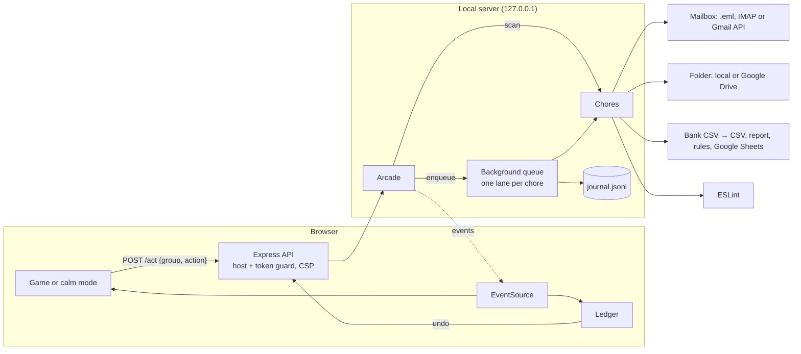

# ChoreCade

**Play a game. Finish a real chore.**

ChoreCade is an arcade where every move you make does a real chore in the background. Shoot down an invader and 400
emails from one sender are archived. Run a crate to the Images door and 46 screenshots move into `Images/`. Choose
FILE when a coffee shop monster attacks and a year of coffee purchases is filed under Food. Beam a crawler in the
castle and ESLint fixes `no-var` across your whole project. Sign in with Google and the same games work on your real Gmail and Drive.

We all put off the same digital chores: 5,000 unread emails, a Downloads folder nobody can look at, expenses nobody has
reviewed, a wall of lint warnings. They aren't hard, just boring and big. ChoreCade turns them into something you can
finish in a five-minute game session.

```bash
git clone https://github.com/hackathonwinner69-tech/SATA-FOR-WIN.git
cd SATA-FOR-WIN
npm install
npm run demo        # builds a sandbox and opens the arcade on http://localhost:4747
```

The demo never touches your real files. It builds a sandbox with a 5,000-email inbox, a cluttered Downloads folder, a
year of bank transactions and a small JavaScript app full of lint, and plays against those.

## The cabinets

| Cabinet | The chore | The game, and how a move becomes real work |
| --- | --- | --- |
| **Inbox Invaders** | Triage 5,000 emails | A shooter. Each ship is one **sender**; its hull grows with how much mail it sent. Archive laser, trash torpedo, unsubscribe EMP or keep beam: a hit moves every email from that sender. Smart bombs apply ChoreCade's pick to every low-risk ship on screen. People are gold ships that take two hits to trash. |
| **Folder Frenzy** | Sort a messy folder | An arena courier game. You drive a robot, pick up crates of look-alike files (`Screenshot … (*.png)` ×46) and run them to bin doors on the walls; a delivery moves the files. Dust bunnies chase you and knock crates loose, and a dropped crate changes nothing. Exact duplicates are red crates found by hash. |
| **Receipt Rush** | Review expenses | Turn-based encounters in the Undertale tradition. Each **merchant** is a monster grown from its name. On your turn choose FILE (pick a category; the suggestion is starred), CHECK, FLAG or SPARE, and that choice is the real action. Then the merchant attacks and you dodge inside the bullet box: subscriptions spiral, big or duplicate charges fall like boulders, regulars rain coins. The categorised CSV, `expense-report.md` and `merchant-rules.json` are rewritten as you play. |
| **Lint Dungeon** | Fix lint errors | A side-scrolling castle crawl in the Metroidvania tradition. Each **lint rule** is a foe: big rules are bosses, fixable ones crawl, the rest fly. Three weapons, three real actions: the Fix Beam runs ESLint's autofix for that rule (and only hurts foes ESLint can fix), the Hush Whip adds marked disable comments, the Quest Scroll writes it to `LINT_QUESTLOG.md`. Whip candles for hearts; the exit door opens when the floor is clear, and the next floor is a fresh lint pass. |

All characters, sprites and levels are original. The games borrow genre mechanics (bullet boxes, whips and beams, locked
doors and minimaps), not anyone's art, music or characters.

Every cabinet also has **Calm mode**: the same chore as a plain table with a native select and an Apply button per
group, with no timer and no canvas. See [Accessibility](#accessibility).

## Why grouping is the trick

Games are fast; chores are big. To close that gap, each move works on a **group**, not one item:

- 5,000 emails come from about 150 senders → **150 shots, not 5,000 decisions.**
- 168 loose files become 16 crates of look-alikes and duplicates.
- 300 transactions come from 27 merchants.
- 47 lint problems come from 12 rules.

Every group arrives with a suggestion (the ring around a ship, the lit door, the starred gate), so most moves are a quick
confirmation, and overruling the suggestion is just as fast.

## Google services

Sign in with Google from the masthead and two new cabinets appear, tagged **your real account**:

- **Inbox Invaders: Gmail.** Your real inbox through the Gmail API. Only headers are read (`format=metadata`), never
  bodies. Archive removes the `INBOX` label (in batches of 1,000); trash uses Gmail's Trash, which keeps mail for 30 days.
  Both can be undone from the ledger.
- **Folder Frenzy: Drive.** A Drive folder (My Drive by default, `--drive-folder <id>` for another). Duplicates are found
  from Drive's `md5Checksum` without downloading anything; bin folders are created on demand; trash is Drive's trash.
  Moves can be undone.
- **Export to Google Sheets.** The expenses cabinet gets an Export button that writes every transaction, its category and
  the totals into a new Google Sheet.

**Setup (about two minutes):**

1. In [Google Cloud Console](https://console.cloud.google.com/), create a project, then enable the **Gmail API**,
   **Google Drive API** and **Google Sheets API**.
2. Configure the OAuth consent screen ("External", add yourself as a test user).
3. Under **Credentials**, create an OAuth client ID of type **Desktop app**.
4. `cp .env.example .env` and fill in `GOOGLE_CLIENT_ID` and `GOOGLE_CLIENT_SECRET`. `.env` is git-ignored.
5. `npm run demo` (or `npm start`) and click **Sign in with Google**.

How sign-in is kept safe: it uses the OAuth 2.0 desktop flow Google recommends for installed apps: PKCE, a one-time
`state` that expires after ten minutes, and a loopback redirect to `127.0.0.1`. Only the refresh token is stored, in
`.chorecade/google-token.json` with owner-only permissions. **Sign out** revokes the grant at Google. Scopes are
`gmail.modify` (move mail; it cannot permanently delete) and `drive` (needed to sort files ChoreCade didn't create).
Sheets values are written `RAW`, so a merchant named `=IMPORTXML(…)` stays text and never becomes a formula.

## Safety model

ChoreCade is allowed to move real mail and real files, so it's careful about it:

- **Everything is undoable.** Every change goes into an append-only journal (`journal.jsonl`) along with what undo needs.
  The ledger beside the cabinets lists each change with an Undo button.
- **Nothing is ever deleted.** "Trash" means Gmail's or Drive's trash, the mailbox's Trash folder, or a
  `.chorecade-trash/` folder you can open.
- **Only deliberate moves act.** A crate you never pick up changes nothing; a merchant is only filed when you choose FILE
  or FLAG on your turn; a lint foe only changes code when you defeat it.
  People are gold ships with a shield.
- **Undo is all-or-nothing and won't clobber.** File moves are reversed only if every original spot is still free. A
  lint undo is refused if the file has been edited since.
- **Unsubscribe is conservative.** RFC 8058 one-click POSTs only go out with `--one-click-unsubscribe` on live mail.
  Otherwise links land in `unsubscribe-queue.md` to click yourself. Links are never fetched with GET.
- **`--dry-run`** journals what would happen without changing anything.
- **The local server is locked down.** It binds to `127.0.0.1`. It refuses requests addressed to any other host name
  (DNS rebinding) and cross-origin requests. It sends a strict Content-Security-Policy, and every API call needs a
  per-run session token. Paths are contained to the folder you named, and symlinks are refused.

## Accessibility

- **Calm mode for every chore**: a real `<table>` with a caption, row headers, a labelled `<select>` per row, and a
  "apply suggestions to low-risk groups" button. No timer, no canvas: it works with a keyboard, a screen reader, or a
  switch device.
- Every real change is announced through a polite live region, and the ledger is always visible.
- Skip link, landmarks, visible focus rings, `role="dialog"` with labelled headings on game overlays, `aria-pressed`
  weapon buttons, distinct accessible names on every Play button, and focus returned to the button that opened a game.
- Text colours meet WCAG AA contrast (4.5:1 or better) on the paper and card backgrounds.
- `prefers-reduced-motion` turns off screen shake, blinking, the guide arrow and most particles.
- Fonts (Silkscreen and IBM Plex, from Google Fonts) are self-hosted through Fontsource: no third-party requests, and the
  page works offline.

## Play with your real stuff

Point ChoreCade at the chores you want. Only those cabinets appear (plus Gmail and Drive once you sign in with Google).

```bash
npm start -- --files ~/Downloads                 # sort a real folder (top-level files only)
npm start -- --expenses ~/statements/2026.csv    # Date / Description / Amount, or Debit / Credit columns
npm start -- --lint ~/code/my-app                # uses the project's own ESLint config if it has one
npm start -- --mail ~/mail-export                # a folder of .eml files with an INBOX/
IMAP_PASS='app password' npm start -- --imap-host imap.example.com --imap-user you@example.com
npm start -- --files ~/Downloads --dry-run       # see what would happen first
```

### Optional: Claude as your sidekick

```bash
export ANTHROPIC_API_KEY=...
npm start -- --ai
```

With `--ai`, when the built-in rules can't place a pack of files (`output.dat`, `mystery.xyz`) or recognise a merchant
(`TST* MYSTERY NOODLE BAR`), Claude (`claude-opus-5-5`, structured output) suggests the bin or category the game
highlights. Claude only suggests; you still make every move. Only file names, merchant names and counts are sent.

## How it works



Every chore implements the same three-method interface, which is what makes a new chore (and a new game) cheap:

```js
scan()                 // → { groups: [{ id, label, count, suggestion, risk, ... }], stats }
apply(group, action)   // → { affected, summary, impact, undo }   does the real work
undo(undoData)         // reverses one apply, or refuses without changing anything
```

Sources plug in underneath: the inbox chore takes a provider (local `.eml`, IMAP or Gmail), and the folder chore takes a
store (local folder or Google Drive). The game never waits on the work: `POST /act` returns `202` straight away, the
queue runs moves one at a time per chore, and Server-Sent Events stream `job`, `change` and `undo` events back to the HUD
and the ledger.

```
src/
  cli.js                 flags → chores → arcade → server
  server.js              Express API, SSE, guards, CSP, self-hosted fonts
  arcade.js              scans, backlog, queue, journal, impact counters
  core/                  journal, queue, safety guards, safe moves
  chores/inbox/          sender grouping, .eml and IMAP providers, unsubscribe
  chores/files/          bins, look-alike packs, duplicates, local folder store
  chores/expenses/       CSV parsing, merchant normalising, report, rules, table for Sheets
  chores/lint/           per-rule ESLint fix, silence, quest log, snapshots
  google/                OAuth (PKCE), Gmail provider, Drive store, Sheets export, routes
  ai/advisor.js          optional Claude suggestions
public/
  js/                    arcade floor, API client, pixel sprites
  games/                 invaders, frenzy, receipts, dungeon, calm mode, shared kit
  games/arena.js, platformer.js, encounter.js   DOM-free game logic, unit-tested in Node
scripts/seed-demo.js     deterministic demo sandbox
test/                    42 tests: chores, undo, server guards, Google (fake API), game logic, advisor
```

No build step and no front-end framework: plain ES modules and `<canvas>`.

## Against the judging criteria

| Criterion | Where to look |
| --- | --- |
| Problem statement alignment | Every game action is a real chore action (`chores/*/index.js` `apply`), run in the background by `core/queue.js` while you keep playing. Inbox, folder, expenses and lint, the four chores in the brief, locally and on Gmail and Drive. |
| Security | `core/safety.js` (host, origin and token guards, path containment, symlink refusal), CSP in `server.js`, OAuth with PKCE and state in `google/auth.js`, RAW Sheets writes, no secrets on the command line, append-only journal with conservative undo. |
| Testing | `npm test`: 42 `node:test` tests covering every chore's apply and undo, the server guards, Google flows against a fake API, the game logic and the advisor. CI on Linux and Windows. |
| Efficiency | One move handles a whole group; mailbox heads are read 16 KB at a time in batches of 200; Gmail fetches headers only with a concurrency pool; Drive duplicates come from server checksums; no front-end build or framework. |
| Accessibility | Calm mode for every chore, live announcements, AA contrast, reduced motion, keyboard play throughout; see [Accessibility](#accessibility). |
| Code quality | One small interface per chore, sources behind providers and stores, pure game logic split from rendering, ESLint clean, no build step. |

## Research notes

Prior art shaped three decisions:

- **Gamifying email isn't new, but the old games work one message at a time.** Baydin's The Email Game (2010–11)
  gave you a timer per message and points per action ([MIT Technology Review](https://www.technologyreview.com/2010/12/02/261028/how-many-points-for-inbox-zero/amp),
  [TNW](https://thenextweb.com/news/the-email-game-adds-more-features-to-turn-gmail-overload-into-light-work)). Swipe apps
  (WypeBox, [Product Hunt](https://hunted.space/product/swipe-to-wipe-emails-wypebox)) do one card per message, and
  IZQuest rewards cleanup with unrelated mini-games ([Product Hunt](https://www.producthunt.com/products/izquest)). At
  5,000 messages, one decision per message is still a chore. In ChoreCade the move itself is the work, and grouping by
  sender makes one shot worth hundreds of emails.
- **One-click unsubscribe has a standard; GET links are a trap.** RFC 8058 needs a `List-Unsubscribe` HTTPS URI and
  `List-Unsubscribe-Post: List-Unsubscribe=One-Click`, answered with a POST and no login
  ([Mailgun](https://www.mailgun.com/blog/deliverability/what-is-rfc-8058/)). Unsubscribing on GET is discouraged
  because scanners fetch links ([Suped](https://www.suped.com/learn/email-deliverability/how-do-i-add-an-unsubscribe-button-to-the-email-header-and-what-is-rfc-8058)).
  So ChoreCade only ever POSTs, only to senders that advertise one-click, and only when you opt in.
- **ESLint can fix one rule at a time.** The Node API's `fix` option takes a predicate over each message, so
  `fix: m => m.ruleId === rule` plus `ESLint.outputFixes` is exactly "kill this boss"
  ([ESLint Node.js API](https://eslint.org/docs/latest/integrate/nodejs-api)).

## Development

```bash
npm test         # node:test
npm run lint
npm run seed     # rebuild the sandbox from scratch
```

CI runs lint and tests on Linux and Windows, Node 22 and 24.

## License

MIT
