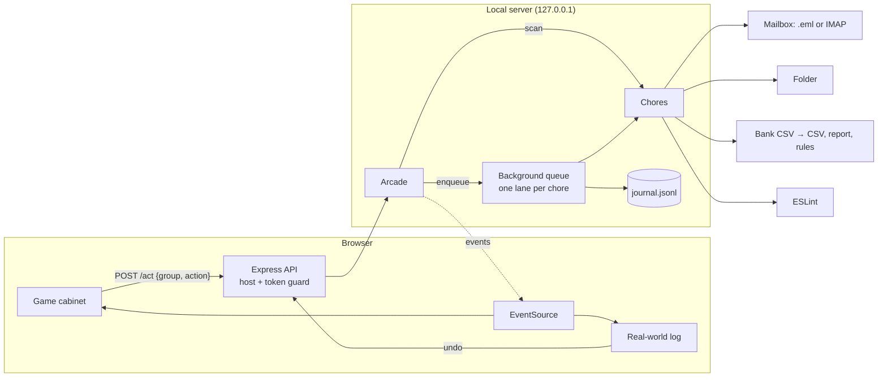

# ChoreCade

**Play a game. Finish a real chore.**

ChoreCade is an arcade where every move you make does a real chore in the background. Shoot down an invader and a sender's
400 emails are archived. Steer a crate into a bin and 46 screenshots move into `Images/`. Swipe a card and a year of
coffee purchases is filed under Food. Slay a dragon and ESLint fixes `no-var` across your whole project.

We all put off the same digital chores: 5,000 unread emails, a Downloads folder nobody can look at, expenses nobody has
reviewed, a wall of lint warnings. They aren't hard, just boring and big. ChoreCade turns them into something you can
finish in a 5-minute game session.

```bash
git clone https://github.com/hackathonwinner69-tech/SATA-FOR-WIN.git
cd SATA-FOR-WIN
npm install
npm run demo        # builds a sandbox and opens the arcade on http://localhost:4747
```

The demo never touches your real files. It generates a sandbox with a 5,000-email inbox, a cluttered Downloads folder, a
year of bank transactions and a small JavaScript app full of lint, then plays against those.

## The cabinets

| Cabinet | The chore | How a move becomes real work |
| --- | --- | --- |
| 👾 **Inbox Invaders** | Triage 5,000 emails | Each ship is one **sender**. Archive laser, trash torpedo, unsubscribe EMP or keep beam: a hit moves every email from that sender. Smart bombs apply ChoreCade's pick to every low-risk ship on screen. People are gold ships that take two hits to trash. |
| 📦 **Folder Frenzy** | Sort a messy folder | Look-alike files fall as crates (`Screenshot … (*.png)` ×46). Steer each into Documents, Images, Media, Code, Archives, Installers, Trash or Leave, and the files move. Exact duplicates are found by hash and glow red. |
| 🧾 **Receipt Rush** | Review expenses | Each card is one **merchant**. File it against the clock and every charge from that merchant is categorised. The categorised CSV, `expense-report.md` (with subscriptions and duplicate charges) and `merchant-rules.json` are rewritten after every card. |
| 🐉 **Lint Dungeon** | Fix lint errors | An interactive crawl. Each monster is one ESLint rule with HP equal to its count. Autofix runs ESLint's own fixer for that rule only, Silence adds a marked `eslint-disable` comment, Quest log writes it to `LINT_QUESTLOG.md`. Each floor is a fresh lint pass, so fixes that expose new problems (say `no-var` turning into `prefer-const`) come back as the next floor's monsters. |

## Why grouping is the trick

Games are fast; chores are big. To close that gap, each game move works on a **group**, not one item:

- 5,000 emails come from about 150 senders → **150 shots, not 5,000 decisions.**
- 168 loose files fall into 16 crates of look-alikes and duplicates.
- 300 transactions come from 27 merchants.
- 47 lint problems come from 12 rules.

Every group arrives with a suggestion (the ring around a ship, the glowing bin, "ChoreCade guesses Food"), so most moves
are one quick confirmation. When you disagree, the game lets you overrule it just as fast.

## Safety model

ChoreCade is allowed to move real mail and real files, so it's careful about it:

- **Everything is undoable.** Every change goes into an append-only journal (`journal.jsonl`) with what undo needs. The
  real-world log in the corner lists each change, with an Undo button.
- **Nothing is ever deleted.** "Trash" means the mailbox's Trash folder or a `.chorecade-trash/` folder you can open.
- **Undo is all-or-nothing and won't clobber.** File moves are only reversed if every original spot is still free. A lint
  undo is refused if the file has been edited since (undo later moves first).
- **People are protected.** Senders who look like people are gold ships with a shield, so trashing or unsubscribing
  needs two hits.
- **A crate you never touch changes nothing.** Only a deliberate move acts.
- **Unsubscribe is conservative.** RFC 8058 one-click POSTs only go out with `--one-click-unsubscribe` on live mail.
  Otherwise links land in `unsubscribe-queue.md` to click through yourself. Unsubscribe links are never fetched with GET.
- **`--dry-run`** journals what would happen without changing anything.
- **The local server is locked down.** It binds to `127.0.0.1` only, refuses requests addressed to any other host name
  (DNS rebinding), refuses cross-origin requests, and needs a per-run session token on every API call. Paths are
  contained to the folder you named, and symlinks are refused.

## Play with your real stuff

Point ChoreCade at the chores you want. Only those cabinets appear.

```bash
# Sort your real Downloads folder (top-level files only)
npm start -- --files ~/Downloads

# Categorise a bank or card CSV export (Date / Description / Amount, or Debit / Credit columns)
npm start -- --expenses ~/statements/2026.csv

# Clean up a JavaScript project with its own ESLint config (or ChoreCade's default one)
npm start -- --lint ~/code/my-app

# A folder of .eml files with an INBOX/ (e.g. an unpacked export)
npm start -- --mail ~/mail-export

# A real IMAP mailbox. Gmail needs an app password; it is read from the environment, never the command line.
IMAP_PASS='xxxx xxxx xxxx xxxx' npm start -- --imap-host imap.gmail.com --imap-user you@gmail.com

# See what would happen first
npm start -- --files ~/Downloads --dry-run
```

On IMAP, "archive" moves to the archive mailbox (Gmail: All Mail, which just drops the Inbox label) and "trash" moves to
Trash. Nothing is expunged, and undo moves the messages back using the UIDs the server reports.

### Optional: Claude as your sidekick

```bash
export ANTHROPIC_API_KEY=...
npm start -- --ai
```

With `--ai`, when the built-in rules can't place a pack of files (`output.dat`, `mystery.xyz`) or recognise a merchant
(`TST* MYSTERY NOODLE BAR`), Claude (`claude-opus-5-5`, structured output) suggests the bin or category the game
highlights. Claude only suggests; you still make every move. Only file names, merchant names and counts are sent, never
file contents or email bodies.

## How it works



Every chore implements the same three-method interface, which is what makes adding a new chore (and a new game) cheap:

```js
scan()                 // → { groups: [{ id, label, count, suggestion, risk, ... }], stats }
apply(group, action)   // → { affected, summary, impact, undo }   does the real work
undo(undoData)         // reverses one apply, or refuses without changing anything
```

The game never waits on the work. `POST /act` returns `202` straight away, the queue runs moves one at a time per
chore (so two moves never race on the same files), and the server streams `job`, `change` and `undo` events back over
Server-Sent Events to drive the toasts, the HUD and the log.

```
src/
  cli.js                 flags → chores → arcade → server
  server.js              Express API, SSE, guards
  arcade.js              scans, queue, journal, impact counters
  core/                  journal, queue, safety guards, safe moves
  chores/inbox/          sender grouping, .eml and IMAP providers, unsubscribe
  chores/files/          bins, look-alike packs, duplicate hashing
  chores/expenses/       CSV parsing, merchant normalising, report and rules
  chores/lint/           per-rule ESLint fix, silence, quest log, snapshots
  ai/advisor.js          optional Claude suggestions
public/
  js/                    arcade floor, API client
  games/                 invaders, frenzy, receipts, dungeon, shared kit
scripts/seed-demo.js     deterministic demo sandbox
test/                    chores, server guards, advisor
```

No build step, no front-end framework: plain ES modules and `<canvas>`.

## Research notes

Prior art shaped two decisions:

- **Gamifying email isn't new, but the old games work one message at a time.** Baydin's The Email Game (2010–11)
  gave you a timer per message and points per action ([MIT Technology Review](https://www.technologyreview.com/2010/12/02/261028/how-many-points-for-inbox-zero/amp),
  [TNW](https://thenextweb.com/news/the-email-game-adds-more-features-to-turn-gmail-overload-into-light-work)). Swipe apps
  (WypeBox, [Product Hunt](https://hunted.space/product/swipe-to-wipe-emails-wypebox)) do one card per message, and
  IZQuest rewards cleanup with unrelated mini-games ([Product Hunt](https://www.producthunt.com/products/izquest)). At
  5,000 messages, one decision per message is still a chore. ChoreCade makes the move itself the work and groups by
  sender, so one shot is hundreds of emails.
- **One-click unsubscribe has a standard; GET links are a trap.** RFC 8058 needs a `List-Unsubscribe` HTTPS URI and
  `List-Unsubscribe-Post: List-Unsubscribe=One-Click`, answered with a POST and no login
  ([Mailgun](https://www.mailgun.com/blog/deliverability/what-is-rfc-8058/)). Unsubscribing on GET is discouraged
  because scanners fetch links ([Suped](https://www.suped.com/learn/email-deliverability/how-do-i-add-an-unsubscribe-button-to-the-email-header-and-what-is-rfc-8058)).
  So ChoreCade only ever POSTs, only to senders that advertise one-click, and only when you opt in.
- **ESLint can fix one rule at a time.** The Node API's `fix` option takes a predicate over each message, so
  `fix: m => m.ruleId === rule` plus `ESLint.outputFixes` is exactly "slay this monster"
  ([ESLint Node.js API](https://eslint.org/docs/latest/integrate/nodejs-api)).

## Development

```bash
npm test         # node:test: chores, undo, server guards, advisor
npm run lint
npm run seed     # rebuild the sandbox from scratch
```

CI runs lint and tests on Linux and Windows, Node 22 and 24.

## Ideas for next

- More cabinets: a photo de-duplicator, a calendar declutterer, a GitHub notifications sweeper, a password-manager
  hygiene pass (reused/weak flags only, no secrets in the browser).
- Gmail API and Microsoft Graph providers next to IMAP.
- Co-op mode: two players clear a shared team inbox.

## License

MIT
